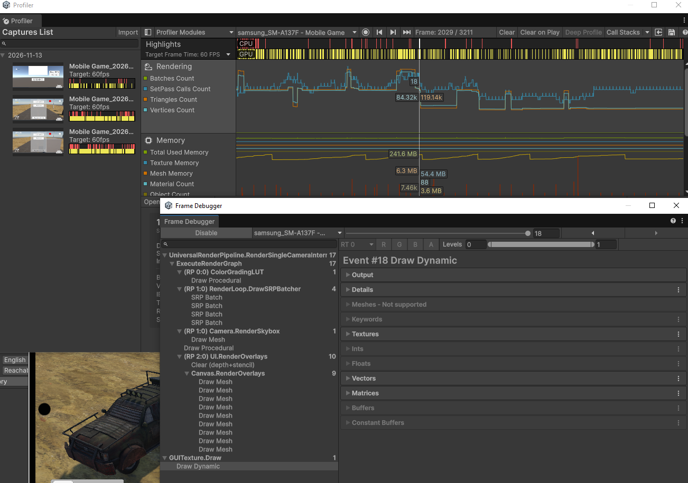

## during spawning
### frame time average
19.32ms at regular spawn intervals. Frame Rate toggle will likely be a important inclusion for my device's spec

### 99th percentile
Consistently around 33.66ms

## GC Alloc per frame,
was measured around 2.3KB per spawn.

**Changed:** Debug.Log + string declarations on each spawn was the cause, and commenting out the Debug.Log line fixed it. 

**Now:** Consistent 0B GC.Alloc for GameManager (The pool manager)

## 5B
### Cold Starts:
1066, 931, 997
Target: 2-3 seconds max

### Time to Interactive:
2026/11/04 22:18:27.241 6897 6935 Info Unity [perf] interactive 2.83s

### Time to Menu:
2026/11/04 22:41:53.959 10031 10090 Info Unity [perf] scene MainMenu loaded in 737 ms

### APK Size:
35.0 MB (ARM32)

Note: There may be time inconsistencies due to me failing to perform the After captures immediately after the soak

| Field | Value                                                                                                          |
|-------|----------------------------------------------------------------------------------------------------------------|
| Build ID and mode | v0.4.0 (xxxxxxxx), Balanced                                                                                    |
| Start temperature (C) | temperature: 281, 14:05                                                                                        |
| End temperature (C) and 10-minute delta | temperature: 310, 14:16 - 29 delta                                                                             |
| Overlay level at minute 0 / 5 / 10 | NoWarning,0.65,0 / NoWarning,0.82,0 / NoWarning,0.82,0 (same)                                                  |
| First `ThrottlingImminent` (minute, logcat time) | Not observed in 10 min, 0.82 max. See below                                                                    |
| `Throttling` observed (yes/no, minute) |                                                                                                                |
| Frame time before: mean / 99th (ms) | mean = 19.78ms    p99 = 37.05ms (taken from Analyser Max value, as lab suggested a P99 value that didn't exist |
| Frame time after: mean / 99th (ms) | mean = 20.23ms    p99 = 45.34 ms                                                                               |
| Conditions | unplugged, brightness 50%, case on (whoops), ambient about 15 C                                                |

First THrottling imminent (much later):
```
<i>AndroidPlayer "Samsung_SM A137F@ADB:R58T9052TRP:0"</i> [Adaptive Performance] SkinTemp=0.85 PerformanceMode=Standard
Performance level CPU=-1/-1 GPU=-1/-1 thermal warn=ThrottlingImminent(1) thermal level=0.85 mode=Automatic
Average GPU frametime = 19.30 ms (Current = 19.95 ms)
Average CPU frametime = 9.32 ms (Current = 9.88 ms)
Average frametime = 20.91 ms (Current = 16.74 ms)
Bottleneck GPU, ThermalTrend 0.186
CPU Boost Mode False, GPU Boost Mode False
Cluster Info = Big Cores: 0 Medium Cores: 0 Little Cores: 0
FPS = 47.81
Performance Mode = Standard
```

## Lab 8B
***build 0.8.0, 14/11/2026***
```bash
R:\Unity Projects\mobile-game>adb shell am start -W com.ryanJackman.coolMobileGame/com.unity3d.player.UnityPlayerGameActivity
Starting: Intent { act=android.intent.action.MAIN cat=[android.intent.category.LAUNCHER] cmp=com.ryanJackman.coolMobileGame/com.unity3d.player.UnityPlayerGameActivity }
Status: ok
LaunchState: COLD
Activity: com.ryanJackman.coolMobileGame/com.unity3d.player.UnityPlayerGameActivity
TotalTime: 674
WaitTime: 700
Complete

R:\Unity Projects\mobile-game>adb shell am start -W com.ryanJackman.coolMobileGame/com.unity3d.player.UnityPlayerGameActivity
Starting: Intent { act=android.intent.action.MAIN cat=[android.intent.category.LAUNCHER] cmp=com.ryanJackman.coolMobileGame/com.unity3d.player.UnityPlayerGameActivity }
Warning: Activity not started, its current task has been brought to the front
Status: ok
LaunchState: HOT
Activity: com.ryanJackman.coolMobileGame/com.unity3d.player.UnityPlayerGameActivity
TotalTime: 99
WaitTime: 107
Complete

R:\Unity Projects\mobile-game>adb shell dumpsys meminfo com.ryanJackman.coolMobileGame | findstr "TOTAL PSS"
        TOTAL   226109   162696    54188      503   302160    46865    38677     8187
           TOTAL PSS:   226109            TOTAL RSS:   302160       TOTAL SWAP PSS:      503

R:\Unity Projects\mobile-game>
```

TotalTime: 
- 674ms + interactive(2.83s) = 3504ms COLD
- 99ms + interactive(2.83s) = 2929ms WARM

Memory:
TOTAL PSS: 226109 (KB) -> 220.80957 MB

Total Mem on Phone: 3779816 kB -> 3,691.2265625 MB


Lab 9A

| Category                 | Budget (MB) | Measured (MB) | Inside? |
|--------------------------|-------------|---------------|---------|
| Textures (incl. atlases) | 50MB        | 4.7MB         | Y       |
| Audio                    | 20MB        | 5.7MB         | Y       |
| Managed heap             | 30MB        | 16.4MB        | Y       |
| Total PSS (from Week 8)  | 1GB         | 220MB         | Y       |


- frame time mean: 17ms
- 99th percentile: 39.2ms
- draw calls and batches (Rendering module):

### Old Numbers (week 3):

SetPass - 125 at start, stable 9

(Batches not recorded)

GC alloc - none




### New Numbers:

main-thread ms - avg 17ms

SetPass - average of 12, peaks at 18

Batches count stays at 0 for whole capture (?)

GC alloc - none


Likely due to improved pooling, the lab downscaling & optimisation instructions, and good coding practice, all the performance values have significantly improved.


