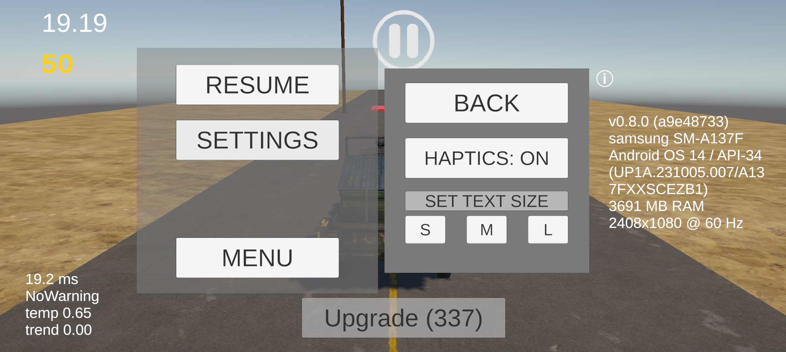

[Link to Builds folder](https://setuo365-my.sharepoint.com/:f:/g/personal/20108256_setu_ie/IgAHrqCVvbktTZ5P6er2giu5AZH01rLueNGDEcDWlhCYodk?e=gMyGT9)

[](Target-Url)

# Week 8 Build info
***v0.8.0 (a9e48733)***
```
R:\Unity Projects\mobile-game>certutil -hashfile "releases/Mobile Game.arm64-v8a.apk" SHA256
SHA256 hash of releases/Mobile Game.arm64-v8a.apk:

c35e7f4f7904789e643b560148d36ebd761746027e3d30443503062bc2a73b87
CertUtil: -hashfile command completed successfully.
```
```
R:\Unity Projects\mobile-game>adb shell dumpsys package com.ryanJackman.coolMobileGame | findstr "versionName versionCode"
    versionCode=100005 minSdk=26 targetSdk=36
    versionName=0.8.0
```
[](Target-Url)