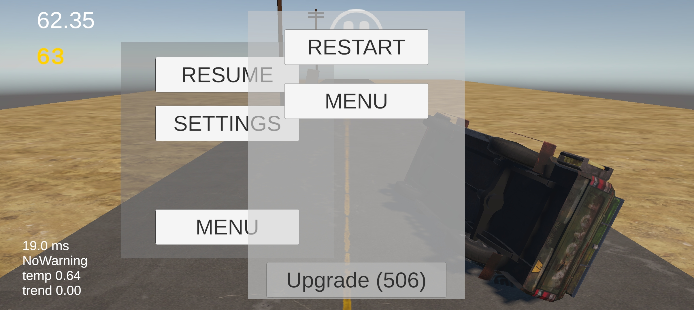
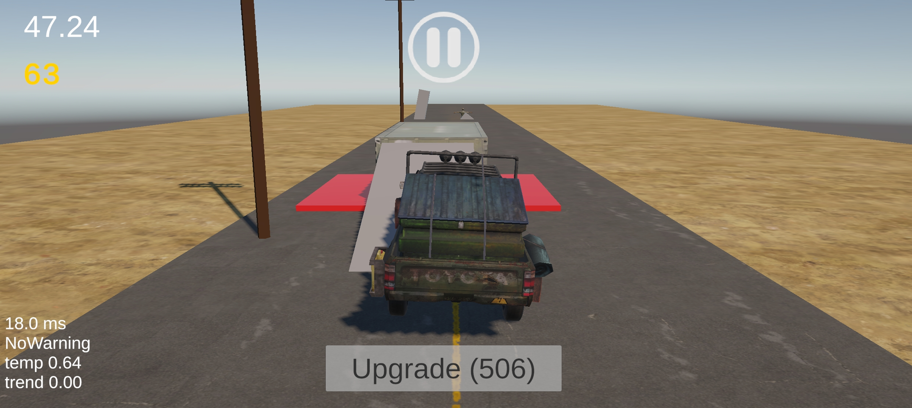
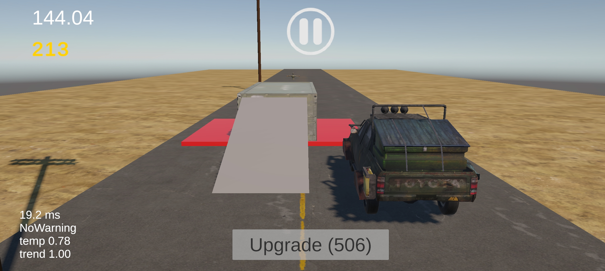
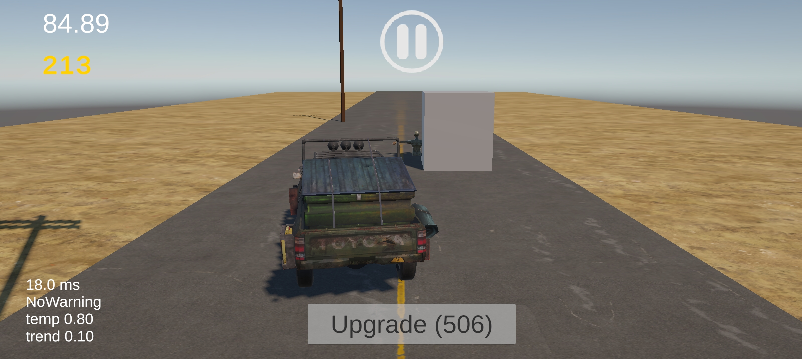
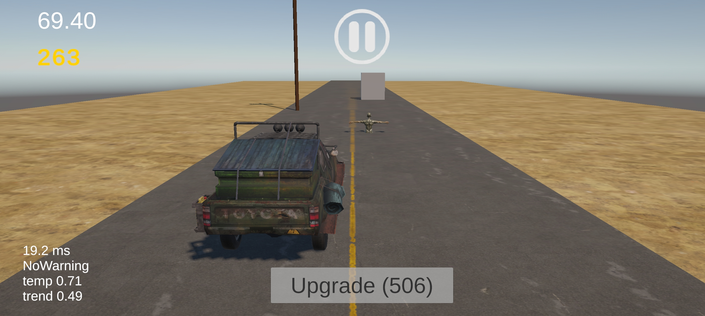

| # | Scenario | Trigger                                                              | Expected | Pass/Fail | Evidence                                                                                             |
|---|----------|----------------------------------------------------------------------|----------|-----------|------------------------------------------------------------------------------------------------------|
| 1 | Resume / background | Home, wait 30 s, relaunch; then force-stop and relaunch. Repeat 10x. | Paused, audio silent, resumes in place; save intact after force-stop | Pass      | Successful reopen & data saved, but error appearing in console (see below)                           |
| 2 | No network | Airplane mode on before launch, and then again mid-play              | No hang, no unhandled exception; online features fail quietly | Pass ?    | Some Android Exceptions, but no Unity issues (see output below)                                      |
| 3 | Rotation | Rotate 180 deg mid-play                                              | Safe areas respected; no stretched UI; no restart | Pass      | Screenshots below of both orientations                                                               |
| 4 | Battery saver | Enable, play 2 minutes                                               | Frame cap respected; playable; overlay shows the change | Pass      | Better performance in HighFPS due to lower render resolution, but no major drop from standard battery mode |
| 5 | Low RAM | Trim memory, background, return                                      | Returns without a black screen; if killed, relaunch restores the save | Pass      | Took photo, browsed Chrome, watched Youtube. No changes in console.                                  |
| 6 | Cold and warm start | Part A commands                                                      | TotalTime recorded; loading screen never hangs | Pass      | [Performance baseline MD](../../CA2/baseline/Performance_Baseline.md)                                |

### Scenario 1 Error:
`11-14 17:12:08.474 28326 28351 E Unity   : java.lang.ClassNotFoundException: Didn't find class "com.google.android.play.core.assetpacks.AssetPackManager" on path: DexPathList[[zip file "/data/app/~~nzUKw58V4yLwP1cuLCSENQ==/com.ryanJackman.coolMobileGame-eKXfxSrh56xDdlwoZvYxtw==/base.apk"],nativeLibraryDirectories=[/data/app/~~nzUKw58V4yLwP1cuLCSENQ==/com.ryanJackman.coolMobileGame-eKXfxSrh56xDdlwoZvYxtw==/lib/arm, /data/app/~~nzUKw58V4yLwP1cuLCSENQ==/com.ryanJackman.coolMobileGame-eKXfxSrh56xDdlwoZvYxtw==/base.apk!/lib/armeabi-v7a, /system/lib, /system_ext/lib]]
1`
This repeated once for all 10 runs

### Scenario 2 Error:
```bash
11-14 17:26:36.754 12087   653 E ActivityManager: Sending non-protected broadcast com.samsung.intent.action.MDE_SUGGESTION_NOTIFY from system 12087:system/1000 pkg android
11-14 17:26:36.754 12087   653 E ActivityManager: java.lang.Throwable
11-14 17:26:36.754 12087   653 E ActivityManager:       at com.android.server.am.ActivityManagerService.checkBroadcastFromSystem(ActivityManagerService.java:17094)
11-14 17:26:36.754 12087   653 E ActivityManager:       at com.android.server.am.ActivityManagerService.broadcastIntentLockedTraced(ActivityManagerService.java:18039)
11-14 17:26:36.754 12087   653 E ActivityManager:       at com.android.server.am.ActivityManagerService.broadcastIntentLocked(ActivityManagerService.java:17182)
11-14 17:26:36.754 12087   653 E ActivityManager:       at com.android.server.am.ActivityManagerService.broadcastIntentLocked(ActivityManagerService.java:17159)
11-14 17:26:36.754 12087   653 E ActivityManager:       at com.android.server.am.ActivityManagerService.broadcastIntentWithFeature(ActivityManagerService.java:18266)
11-14 17:26:36.754 12087   653 E ActivityManager:       at android.app.ContextImpl.sendBroadcast(ContextImpl.java:1285)
11-14 17:26:36.754 12087   653 E ActivityManager:       at com.samsung.android.server.wifi.ap.SemWifiApUtils$2.run(SemWifiApUtils.java:24)
11-14 17:26:36.754 12087   653 E ActivityManager:       at java.lang.Thread.run(Thread.java:1571)
11-14 17:26:36.957 12087   681 E ActivityManager: Sending non-protected broadcast com.samsung.intent.action.MDE_SUGGESTION_NOTIFY from system 12087:system/1000 pkg android
11-14 17:26:36.957 12087   681 E ActivityManager: java.lang.Throwable
11-14 17:26:36.957 12087   681 E ActivityManager:       at com.android.server.am.ActivityManagerService.checkBroadcastFromSystem(ActivityManagerService.java:17094)
11-14 17:26:36.957 12087   681 E ActivityManager:       at com.android.server.am.ActivityManagerService.broadcastIntentLockedTraced(ActivityManagerService.java:18039)
11-14 17:26:36.957 12087   681 E ActivityManager:       at com.android.server.am.ActivityManagerService.broadcastIntentLocked(ActivityManagerService.java:17182)
11-14 17:26:36.957 12087   681 E ActivityManager:       at com.android.server.am.ActivityManagerService.broadcastIntentLocked(ActivityManagerService.java:17159)
11-14 17:26:36.957 12087   681 E ActivityManager:       at com.android.server.am.ActivityManagerService.broadcastIntentWithFeature(ActivityManagerService.java:18266)
11-14 17:26:36.957 12087   681 E ActivityManager:       at android.app.ContextImpl.sendBroadcast(ContextImpl.java:1285)
11-14 17:26:36.957 12087   681 E ActivityManager:       at com.samsung.android.server.wifi.ap.SemWifiApUtils$2.run(SemWifiApUtils.java:24)
11-14 17:26:36.957 12087   681 E ActivityManager:       at java.lang.Thread.run(Thread.java:1571)
11-14 17:26:37.748 12087   839 E ActivityManager: Sending non-protected broadcast com.samsung.intent.action.MDE_SUGGESTION_NOTIFY from system 12087:system/1000 pkg android
11-14 17:26:37.748 12087   839 E ActivityManager: java.lang.Throwable
11-14 17:26:37.748 12087   839 E ActivityManager:       at com.android.server.am.ActivityManagerService.checkBroadcastFromSystem(ActivityManagerService.java:17094)
11-14 17:26:37.748 12087   839 E ActivityManager:       at com.android.server.am.ActivityManagerService.broadcastIntentLockedTraced(ActivityManagerService.java:18039)
11-14 17:26:37.748 12087   839 E ActivityManager:       at com.android.server.am.ActivityManagerService.broadcastIntentLocked(ActivityManagerService.java:17182)
11-14 17:26:37.748 12087   839 E ActivityManager:       at com.android.server.am.ActivityManagerService.broadcastIntentLocked(ActivityManagerService.java:17159)
11-14 17:26:37.748 12087   839 E ActivityManager:       at com.android.server.am.ActivityManagerService.broadcastIntentWithFeature(ActivityManagerService.java:18266)
11-14 17:26:37.748 12087   839 E ActivityManager:       at android.app.ContextImpl.sendBroadcast(ContextImpl.java:1285)
11-14 17:26:37.748 12087   839 E ActivityManager:       at com.samsung.android.server.wifi.ap.SemWifiApUtils$2.run(SemWifiApUtils.java:24)
```
This is a small snippet. The whole log can be seen in [terminal 2 output](terminal%202%20output.txt)

### Scenario 3 Screenshots
Left
[]()
Right
[]()

### Scenario 4 Screenshots
Power saving ON
[]()
Power saving OFF
[]()
note the small increase in frame time for ON


### Scenario 5 Screenshots
Returning after RUNNING_CRITICAL command
[]()
working fine, game reloads fine