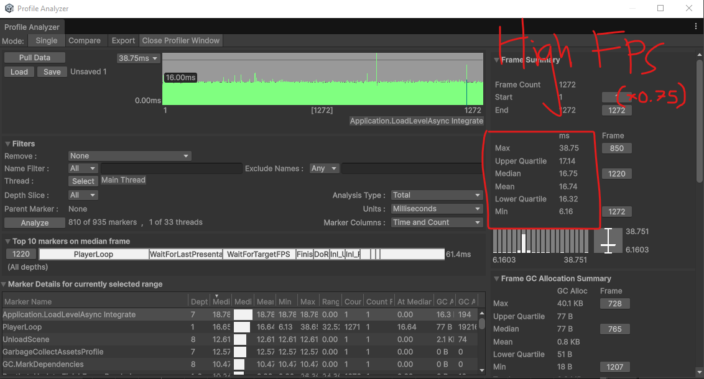
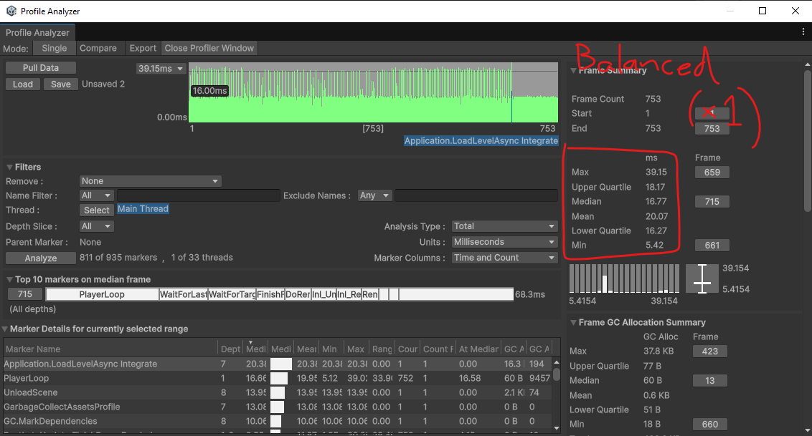

14-09-2026

I had struggled with getting Unity 6 to install
I was stuck trying to get the build to run on my phone, and had to enable ARMv7 build support.
The game eventually succesfully installed and can now run on its own on my phone.

Selected Idea:
# 2 - Endless Runner
### Core Verb (?) - Drive

## Including:
- Procedural Biomes
- chunk generator 
- difficulty curves
- pooling. 

### Vertical-slice by W6: 1 biome, 10+ chunks, mission system, Android device build.

The main cut list of this project will be (in increasing order of importance):
- difficulty curves

16-09-2026

 CPU main thread ms: 6ms
 SetPass calls: 0 (?)
 GC allocated in frame: 4, 36B

21-09-2026
Checklist
| Test | Expected | |
|------|----------|-|
| Press Home, wait 10 s, return | Paused, panel visible, audio silent, progress saved | |
| Pull the notification shade down and up | Paused | |
| Neighbour calls you, you hang up | Paused, game resumes only on Resume | |
| Screen off with the power button, back on | Paused | |
| Force stop from Settings, relaunch | Progress restored from the save | |

25-09-26

did a little bit more. getting the car moving and trying to test on mobile was taking too long, so once I knew the touch detection was working as expected, I attached a KeyboardInput script and a PLayerInput Component to allow testing the game on my PC with rudimentary controls. This will speed up development a lot. Haptics are ready to be wired in later once things are added.

commented out main game loop methods, may need further additions but looks good for now

28-05

created car test model

created ramp, rudimentary jumps work

game props will use new MoveWithWorld component to "scroll" to emulate the car driving.

29-09

introduced & implemented basic object Pool

improved the car handling, this is likely how it wil stay for the final project

added terrain

30-09
 worst-frame main-thread ms = 38ms
 the tallest marker name = PostLateUpdate.FinishFramerendering
 top three hierarchy entries = PostLateUpdate.FinishFramerendering, PhysicsFixedUpdate, PresentAfterDraw
  GC.Collect no

03-10 
worked a lot today on the CA1 spec requirements.
I used a privacy policy generator website to make a Privacy Policy and Data Safety statemet for the game. I was dissatisfied with the unclear wording, so changed it to a ChatGPT-generated version.

04-10
actually continued the labs today. Did not realise the labs contained so much work on the CA1 files.

For the Part D: RenderScaleProbe test, here are the values
Before Toggle
Main Thread CPU time: between 17 - 33 ms
Gfx.WaitForPresentOnGfxThread: wild jumping between 8 - 25 ms

After toggle
Main Thread CPU time: early hovered around 16.7, before spikes started appearing again, less frequently than before.
Gfx.WaitForPresentOnGfxThread: average of 8-10 ms

Conclusion: more consistent time ms and less spikes on both CPU and GPU at low res, but minimum frame time did not drop very far. First conclusion is GPU-bound, but it may also point to not enough happening in game as of this version (no textures, simple models, etc)

REST (no menu yet)
2026/10/04 18:02:38.984 25221 25241 Info Unity [Baseline] avg 18.85 ms  p99 33.69 ms
GAMEPLAY (no high intensity case for this build, as the SpawnMany button is hidden)
2026/10/04 18:04:19.375 25221 25241 Info Unity [Baseline] avg 18.93 ms  p99 33.63 ms

5-10
Optimisations noted to focus on for Lab 5A:
- One manager ticks a List<ITickable>; hundreds of Update methods cost call overhead​
- Disable components that have nothing to do this frame​
- Never GetComponent, Find or Camera.main in a loop; cache in Awake​
- Use FixedUpdate only for physics; keep it light​

- Awaitable: Implement basic timers for reference, so they can be used instead of Coroutines if needed later.
    (Ask Pino if suitable for project)

- Ensure that Prewarm to the worst wave in Awake, behind the loading screen​
- add comment: Reset state on SPAWN: health, velocity, trails, timers​
- Cap the pool and log if you exceed it (compare to lab implementation)

Potential issues/checks:
  - Stale references: a released enemy is still targeted by another script​
  - Particle systems and trail renderers need Clear() on release​ (unlikely for this project)
  - A Rigidbody keeps its velocity; be sure to zero it on spawn​

***No coroutines in project***

1-11
Finally returned to working on game by continuing lab 5

3-11
added models for lab 5A and credited sources

Finished Lab 5A:

No coroutines found, as I had already implemented the Pool and spawn intervals with a rudimentary timer.

GC Alloc per-spawn: 2.3KB -> 0B

Surprising was that Debug.Log calls created such large memory allocation. Maybe using just a print() call would be smaller.

4-11
Finished Lab 5B
Need to revist part C & E

5-11
Finished Lab 6A

Skipped the last step to make up for lost time. I've decided that gameplay balancing and pacing can be handled at a later date.

I have added the Part E instructions to the Gamemanager as a TODO

9-11

2026/11/09 00:02:31.279 3417 3477 Info Unity [telemetry] 2.47 51e6c34c session_start app_version=0.3.1 device_model=samsung SM-A137F android=Android OS 14 / API-34 (UP1A.231005.007/A137FXXSCEZB1)

[telemetry] 1.77 7fe1094d level_start level_id=Game attempt=2 coins=0
UnityEngine.Debug:Log (object)
Telemetry:Log (string,System.ValueTuple`2<string, object>[]) (at Assets/Scripts/Telemetry/Telemetry.cs:18)
GameManager:NewGame () (at Assets/Scripts/GameManager.cs:96)
GameManager:Awake () (at Assets/Scripts/GameManager.cs:47)

[telemetry] 8.93 2a82a623 level_gameOver level_id=Game time_s=5.899941 coins_earned=0 score=60.0206277668476
UnityEngine.Debug:Log (object)
Telemetry:Log (string,System.ValueTuple`2<string, object>[]) (at Assets/Scripts/Telemetry/Telemetry.cs:18)
GameManager:GameOver () (at Assets/Scripts/GameManager.cs:127)
PlayerCarController:Crash (bool) (at Assets/Scripts/Player/PlayerCarController.cs:88)
UnityEngine.Component:SendMessageUpwards (string,object)
CrashDetector:OnTriggerEnter (UnityEngine.Collider) (at Assets/Scripts/Player/CrashDetector.cs:27)


[telemetry] 51.60 af133ca9 upgrade_purchased upgrade_id=speed level=4 cost=337 coins_left=388
UnityEngine.Debug:Log (object)
Telemetry:Log (string,System.ValueTuple`2<string, object>[]) (at Assets/Scripts/Telemetry/Telemetry.cs:18)
Wallet:TryUpgrade () (at Assets/Scripts/Economy/Wallet.cs:22)
UI_WalletHUD:Upgrade () (at Assets/Scripts/UI/UI_WalletHUD.cs:20)
UnityEngine.EventSystems.EventSystem:Update () (at ./Library/PackageCache/com.unity.ugui@23caec89ae27/Runtime/UGUI/EventSystem/EventSystem.cs:527)

11-11
Lab 6B Part D: Save and resume proof:
1. Background and resume - Success
2. Force-stop and relaunch - Success
3. Low-memory kill while backgrounded - Success
4. Log pull - Success

***Reflection due on Due Sun 1 Nov 2026, 23:59 (missed)***

12-11
LAb 7A Part D:
Perfmode flip working
```
2026/11/12 13:36:22.747 5232 5267 Info Unity perf_mode=Balanced, high=False
2026/11/12 13:39:21.081 5232 5267 Info Unity perf_mode=HighFPS, high=True
```

Balanced:
```
2026/11/13 00:28:18.249 20738 20813 Info Unity [AP] bottleneck=Unknown
2026/11/13 00:28:19.907 20738 20813 Info Unity [AP] bottleneck=GPU
2026/11/13 00:28:25.619 20738 20813 Info Unity [AP] bottleneck=Unknown
2026/11/13 00:28:27.115 20738 20813 Info Unity [AP] bottleneck=GPU
2026/11/13 00:28:35.990 20738 20813 Info Unity [AP] bottleneck=Unknown
2026/11/13 00:28:39.657 20738 20813 Info Unity [AP] bottleneck=TargetFrameRate
```

[](target-url)

HighFPS:
```
2026/11/13 00:30:20.307 20738 20813 Info Unity [AP] bottleneck=Unknown
2026/11/13 00:30:22.002 20738 20813 Info Unity [AP] bottleneck=TargetFrameRate
```

[](target-url)

The lack of logs in HighFPS - when both modes had a similar playtime - is likely due to the 60FPS cap caused by my phone's 60Hz screen. The change is essentially just a resolution reduction
No thermal warnings were triggered during this test, but were confirmed to appear at an earlier time of day

13-11

Lab7B:

sustained budget for my phone: 60FPS is not feasable, and 30FPS will be a better target.

Review of requirements for CA2 (not including Labs)
TODO DONE (15-11) I will add a new graphics mode for best performance that caps at 30, at a slightly lower resolution
TODO DONE (15-11) Move Upgrade button to MainMenu, make it upgrade player's health OR damage resistance, link player health to fail condition, and make zombies damage the car
TODO SO Zombies - DONE (behaviour in, see 15-11; animations + tuning left)
TODO Fuel Meter; new player lose condition. If fuel is not collected often enough, player car Die()
TODO Fuel item and Repair kit item. (Repair kit DONE 15-11; fuel not decided)

14-11

TODO Skipping Lab 8B, part CDE, need to return later after more is added to base game
TODO Async Pack 3: Peer APK Distribution & Survey is now live. It runs to Sun 29 Nov 2026 and feeds the CA3 QA evidence pack:
TODO DONE (15-11) add haptic feedback to actions
TODO DONE (15-11) Move PlayerCarController force code (AddForceAtPosition) from Update() to FixedUpdate().

TODO Lab9A Part C needs to be revisted for future changes and for audio, materials, and UI. Was required for demo, now should be part of the CA2 entirely

15-11

Car prep for zombies. Drive and steer forces now run in FixedUpdate, using the Rigidbody's pose rather than the transform. 
Rigidbody interpolation is switched on (in Awake) so zombies attached to the window triggers (FL/FR/BL/BR) move smoothly with the car instead of stepping at the physics rate.

Zombies (first pass, code only). EnemyController is now a state machine: Waiting -> Chasing -> Leaping -> Attached -> Falling -> Down (or GaveUp if it passes the car with no free window).
- Chasing: runs out to the car's flank and forward with the car, on top of MoveWithWorld's scroll.
- Leaping: claims a free window trigger (FL/FR/BL/BR) on its side, max one zombie per window, then arcs onto it, re-aiming every frame so steering mid-leap doesn't make it miss. Its collider is off so it can't set off the Top crash trigger.
- Attached: parented to the window, drains car health, haptic pulse on landing. Holding a hard turn for ~0.6s throws it off.
- Supporting changes: MoveWithWorld now moves in world space (zombies rotate), Pool.spawn unparents objects, ResetCar refills health, zombie collider is a trigger.
- Still needed: run/jump/cling animations (Animator int parameter "State"), remove the placeholder capsule mesh, tune numbers in play.


Zombie scraping. While a zombie hangs on a window its trigger collider is switched back on. Because it's now a child of the car's Rigidbody it can't set off the car's own Top/Front triggers, but it does report obstacles it brushes past, which throws it off harder than shaking does (plus a haptic pulse). An obstacle is anything on the "Obstacle" layer; until that layer exists, it's any solid collider that has MoveWithWorld and isn't a zombie or the car. The car's ground-check raycast now ignores triggers.
TODO DONE (15-11) Set up layers: Player, Enemy, Obstacle, and the Enemy row in the physics collision matrix (see priorities.md).

Health, health bar and variable speed.
- Health is the fail condition (as before, health 0 -> Die -> GameOver). Low speed is a penalty only, not a fail state (decision recorded in priorities.md).
- Bug fixed: UpgradeHealth ran on every Wallet.Changed, including coins earned, and healed 40 each time, so running over a zombie also healed the car. It now only recalculates maxHealth; ResetCar fills health each round.
- PlayerCarController.HealthChanged event + UI_HealthBar (filled Image, colour gradient, optional "64/110" label).
- Speed: GameManager now has baseSpeed (the difficulty ramp) and currentSpeed (what the world scrolls at). ApplySpeedPenalty knocks a share off currentSpeed (never below 35% of base) and it recovers toward baseSpeed at 2/s. The ramp no longer runs during GameOver, which was making the world creep after the slowdown finished.
- Penalties: side scrapes on obstacles 20% (0.5s cooldown, ramps excluded by contact normal), SlowArea hazards 25% once per spawn, head-on zombie hits 15% (coins kept, plus a haptic pulse).
- Upgrade is now "Max health +10", telemetry upgrade_id "health". UI_WalletHUD fields are optional so the button can move to the main menu.
- Shared Obstacles.IsObstacle() used by zombie scraping and car scrapes.

Front hitbox split. The wide Front trigger was crashing on obstacles beside the car. 
CrashDetector now has Kills Enemies and Crashes options (both on by default), and no CrashDetector crashes on other triggers any more (slow areas used to end the run via Front). 
Setup: Front = wide, Crashes off (rams zombies only). New FrontCrash = slim, bonnet-width, Kills Enemies off (obstacle crashes only). Top = Ground Only. Watch: FrontCrash touching a ramp slope ends the run, so keep it above the slope's leading edge.

Rest of P1: game over cause and presentation, haptics.
- GameOver takes a DeathCause (Crashed, Flipped, OutOfBounds, Overrun). Front crash = Crashed, Top (Ground Only) = Flipped, Game Over zones = OutOfBounds, health 0 = Overrun. Logged as `cause` in level_gameOver.
- Bug fixed: coins_earned in telemetry was always 0 (roundCoinsEarned was never added to). Zombie coins now go through GameManager.EarnCoins.
- Results panel waits 1.2s (realtime) so the crash or stall is visible, then shows the cause and distance (optional labels on UI_ResultsMenu).
- Overrun death: the car no longer has its constraints released, so it stalls and coasts to a stop with zombies still on it instead of tumbling like a crash.
- Haptic pulse on crashes added; zombie hit, scrape and knock-off were already in. Pickups wait for the repair pickup.

Repair pickup.
- RepairPickup: trigger, scrolls with MoveWithWorld, heals 30 when the car drives through it (only while playing), haptic pulse, returns to the pool. A zombie hanging on the car can't collect it for you. Optional "visual" child spins and bobs.
- Placement follows the MDA's "hard-to-reach spots": obstacle prefabs can have PickupSpot children (empty child, green gizmo). When an obstacle spawns there's a 30% chance a pickup appears on one of its spots. Without chunks yet, there's also an occasional pickup in the open road every 200-350 units.
- GameManager: itemPool (4, uncapped) created only if repairPickupPrefab is assigned, reset in NewGame (closes the old itemPool TODO).

Repair pickup, reworked. Pooling pickups separately didn't work: with MoveWithWorld on a pickup parented to an obstacle it scrolled twice as fast, and a collected box stayed off when the obstacle came back from the pool.
- Pickups are now children of obstacle prefabs. ObstaclePickups on the obstacle root re-rolls them in OnEnable on every spawn (30% chance, max 1 shown by default), so collected boxes come back.
- RepairPickup no longer requires MoveWithWorld. PickupSpot and the GameManager pickup pool/free spawning are removed.
- Open-road pickups need no code: a "pickup only" obstacle prefab (empty root + MoveWithWorld + ObstaclePickups + a Repair Box child) in the obstacle list.

Audio system.
- AudioManager (Assets/Scripts/Audio) lives in the Boot scene and persists (DontDestroyOnLoad). Static calls: AudioManager.Play(Sfx.X), SetEngine(running, speed), SetSkid(0..1). All are no-ops if there's no AudioManager, so the Game scene still runs on its own.
- One-shots use a pre-made pool of 8 AudioSources (no allocation per sound), random clip and pitch jitter per sound, and a per-sound minimum interval so bursts (many zombies groaning) don't stack. UI clicks use 2 sources that ignore AudioListener.pause, so the pause menu still clicks.
- Loops: engine pitch follows world speed, tyre screech volume follows yaw rate, both fade out at game over. Music is picked per scene by name with a fade, using unscaled time (no coroutines).
- Music/SFX volume are PlayerPrefs settings like Haptics, with UI_VolumeSlider for a settings menu. UI_ButtonSound adds a click to any Button/Toggle without OnClick wiring.
- 15 sound calls hooked into zombies, car, slow areas, pickups, coins, upgrades and the results panel. Shopping list and import settings in docs/audio.md.
